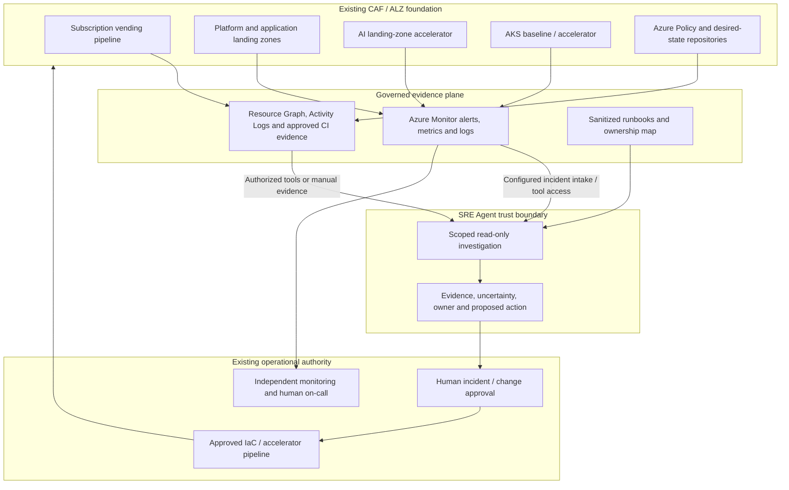

# Azure SRE Agent - Foundation starter kit

**Audience:** CCoE, Azure platform/landing-zone teams, observability/SRE, security, FinOps, AI platform, and AKS platform owners. **Reference date:** 20-10-2026.

## Executive recommendation

Use Azure SRE Agent as a **governed investigation and operations assistant on top of the existing Azure foundation**, not as a replacement for ALZ, Azure Policy, subscription vending, monitoring, CI/CD, on-call response, or workload ownership. Begin with read-only evidence gathering; keep platform changes in the approved IaC/release process.

The strongest initial cases are **failed subscription vending, baseline readiness, shared DNS/private connectivity, AKS platform triage, and incident-to-WAF follow-up**. Extend to AI landing-zone onboarding/capacity and controlled lifecycle/recovery reviews after access, telemetry, and evidence quality are proven.

This is an **independent reference design grounded in Microsoft guidance**, not a Microsoft product feature bundle, official certification, or a production-ready deployment. Sources and product caveats are in the setup guide and research reports. The documentation needed no tenant or workplace data. A **reference deployment** (`infra\sre-agent`) was applied to a sandbox subscription on 20-10-2026 to prove the IaC and data-plane configuration. It is a pilot, not a production attestation.

**Important adoption gates:** SRE Agent documentation contains conflicting regional availability and run-mode descriptions; confirm the target subscription's actual portal behavior. Its REST/ARM API and some connectors are explicitly preview; this kit does not assert a verified overall GA date. The AI landing-zone accelerator is also explicitly preview and is a **workload landing-zone accelerator**, not a substitute for the platform landing zone. SRE's resource-access **Reader preset is not a guarantee of zero write permissions**: inspect its generated role assignments and enforce tool/access boundaries before connecting alerts.

## Contents and reading order

| File | Purpose |
|---|---|
| [setup-guide.md](setup-guide.md) | Common prerequisites, product setup, access boundaries, alert intake, accelerator onboarding, and pilot gates |
| [agent-topology.md](agent-topology.md) | When one agent serves all use cases and when to split; separate-agent versus new-use-case triggers; per-use-case placement |
| [use-cases.md](use-cases.md) | Twelve prioritized use cases with instructions, owners, exercises, benefits, metrics, and agent placement |
| [waf-pillar-use-cases.md](waf-pillar-use-cases.md) | One deep-dive use case per WAF pillar (W1-W5): signals, set-up, exercise, measures, and CCoE/team benefit |
| [costs.md](costs.md) | Verified EUR/USD retail snapshot, cost assumptions, exclusions, and business-case worksheet |
| [infra\README.md](infra/README.md) | Optional AVM Bicep monitoring skeleton; deliberately not an agent/ALZ deployment |
| [infra\sre-agent\README.md](infra/sre-agent/README.md) | **Reference deployment** of one platform agent: Bicep (agent, identity, RBAC, incident platform, connectors) plus data-plane configuration (13 custom agents, 8 Review-mode scheduled tasks, 8 response plans, knowledge) |
| [demo-guide.md](demo-guide.md) | Scripted demo path (demos 0-9): trigger actions, expected agent behaviour and proposed fixes for ALZ (AMBA, guardrails, vending, AKS) and the five WAF pillars |
| [queries\starter-queries.kql](queries/starter-queries.kql) | Bounded investigation examples, with Log Analytics versus Resource Graph clearly separated |
| [research-sre-agent.md](research-sre-agent.md) | Product capability/source evidence and documentation ambiguities |
| [research-foundations.md](research-foundations.md) | CAF/ALZ/vending/AI/AKS first-party evidence |
| [decision-maker-deck.pptx](decision-maker-deck.pptx) | Decision-maker presentation; notes include evidence and assumptions |
| [STARTERKIT.md](STARTERKIT.md) | Single-page implementation playbook, generated from the source Markdown by `tools/build-playbook.py` |
| [verification.md](verification.md) | What was checked locally versus what requires a target Azure environment |

Paths in PowerShell examples use Windows backslashes. Markdown hyperlinks use URL path syntax.

## Scope, assumptions, and decisions

| Topic | Reference assumption / recommendation | Decision before customer production use |
|---|---|---|
| Foundation | Existing CAF-aligned ALZ with platform and application landing zones | Actual management groups, subscriptions, policy assignments, vending pipeline, and source-of-truth repository |
| Cloud/region | Azure public cloud, EU-focused evaluation | Supported agent/model regions, processing/storage geography, contractual terms, residency and cross-border support access |
| IT/OT | IT platform only; no OT connectivity or operational control | Identify critical functions; require a separate assessment before any IT/OT integration |
| Regulation | No regulation assumed | Applicable sector/entity obligations, records retention, incident reporting, data classification |
| Availability | Normal on-call and monitoring remain independent of the agent | Service criticality, SLOs, support model, outage/manual fallback and tested RTO/RPO |
| Autonomy | Read-only pilot; explicit approval for any change | Approved action allow-list, execution identity, scope, rollback, audit and incident authority |
| IaC | Bicep, AVM where suitable; reuse existing accelerators | Pin approved versions; deployment identity, pipeline gates, what-if and policy evaluation |
| Integrations | Only explicitly configured/documented product integrations | ITSM/CI/GitOps authentication, permissions, data egress and ownership |

Do not infer that an EU workspace makes all agent processing EU-resident. A private endpoint to a workload does not establish a working private route from SRE Agent. Treat both as explicit acceptance gates.

## Reference architecture

The diagram shows logical responsibilities, not a claim that every arrow is a native connector. The first implementation may pass sanitized evidence manually.

**Design decisions:** preserve the ALZ management-plane hierarchy; do not create a new management group solely for the agent. Place the agent and operational integrations in an approved management/platform subscription and resource group, subject to current service support. **Agent topology:** use **one agent per operating team, with use cases inside it**. Typically this is one platform-operations agent for UC01-UC12, implemented through custom agents, response plans, and scheduled tasks. Create a separate agent only when one of these must differ:
- team/on-call
- permissions or security boundary
- incident platform
- model provider/data residency
- budget
- tenant
- hosting region/network path

Production versus test alone is not a split reason **while the agent is read-only and in Review mode**. Once it has write access or Autonomous plans, separate prod and non-prod. See [agent-topology.md](agent-topology.md).

Keep observation and execution separate. A prompt stating "do not change anything" is useful behavioral guidance, **not an authorization control**. RBAC, tool capabilities, connector credentials, Kubernetes authorization, pipeline gates, and response-plan modes must enforce the boundary. Treat logs, repository content, and knowledge as untrusted data: do not execute instructions embedded in them.

## WAF assessment of this reference design

This is a design review, **not a numeric WAF assessment or compliance attestation**. Platform services are assessed as workloads; consuming applications still need their own WAF review and business health models.

| Pillar | Starter-kit contribution | Tradeoff / remaining gap | Production acceptance evidence |
|---|---|---|---|
| Reliability | Faster evidence correlation; clear owners; tested incident/restore playbooks | Agent, connector, or allocation outage must not prevent human response; no guaranteed MTTR reduction | Original alert reaches on-call without agent; fallback drill; measured user-flow recovery and service-specific RTO/RPO |
| Security | Read-only scope, managed identity where supported, separate executor, sanitized context | Platform logs may reveal sensitive configuration; connector/tool credentials can bypass intended scope | RBAC/Kubernetes/tool negative tests; redaction review; approved data/residency and network path; action audit |
| Cost Optimization | One scoped pilot, filtered intake, usage/allocation controls, EUR cost tracking | Fixed always-on charges remain while stopped; extra telemetry and model reasoning vary | Approved incremental budget; actual AAU/incident and ingestion baseline; continued on-call coverage at allocation exhaustion |
| Operational Excellence | Common evidence contract; runbooks; IaC source of truth; incident-to-improvement loop | Knowledge/runbooks can become stale; excessive alerts cause repeated investigations | Named owner, last-reviewed dates, tested alerts, source-linked reports, release and rollback drills |
| Performance Efficiency | Capacity/throttle correlation for AI and AKS; bounded query windows | Large cross-subscription queries and context increase latency/cost; quota does not guarantee capacity | Load/scale tests against agreed SLOs; query timeouts/scope; capacity and quota headroom with service owners |

Sources: [WAF pillars](https://learn.microsoft.com/en-us/azure/well-architected/), [OE:07 monitoring](https://learn.microsoft.com/en-us/azure/well-architected/operational-excellence/observability), [OE:11 safe deployment](https://learn.microsoft.com/en-us/azure/well-architected/operational-excellence/safe-deployments).

## Ownership and operating model

The CCoE governs the reusable pattern and decision criteria; it need not become the 24/7 operations team. Assign one accountable service owner for every case before onboarding.

| Activity | Accountable | Responsible / consulted |
|---|---|---|
| Starter-kit standards, baseline acceptance, exceptions | CCoE governance lead | Platform architecture, security, operations, workload representatives |
| Agent service, knowledge lifecycle, connectors, usage controls | Platform operations service owner | Observability/SRE administrators; security reviews access |
| Vending and baseline changes | Landing-zone/vending service owner | Vending pipeline maintainers; subscription/billing administrators |
| Shared networking and private DNS | Network platform owner | Network responders; affected workload teams |
| AI foundation and capacity | AI platform owner | Network/identity/security, workload owner, FinOps |
| AKS cluster lifecycle and shared services | AKS platform owner | Cluster operators; application owners for disruption and manifests |
| Application behavior and end-to-end SLO | Workload owner | Application team; platform consulted on dependencies |
| Access/data approvals and security exceptions | Authorized security/data owner | IAM, privacy/legal/compliance as applicable; CCoE consulted |
| Incident command and production changes | Existing incident/change authority | Platform/workload responders; SRE Agent has no accountability |

## Suggested four-week pilot

This is an illustrative sequence, not a deployment-time commitment. Stop at any failed gate rather than promoting on a calendar date.

| Phase | Work | Exit evidence |
|---|---|---|
| Week 1 - establish boundaries | Select one sandbox trust boundary, identify owners, record region/data decisions, verify telemetry and read-only access | Signed scope; source-linked query evidence; negative access test; manual fallback |
| Week 2 - manual investigations | Run UC01, UC03, UC08 and UC12 against known incidents/safe exercises; add UC02/UC05 readiness checks | Correct owner and supported diagnosis; explicit unknowns; zero writes; responder review |
| Week 3 - controlled intake | Connect a small alert set; test filters/deduplication and active-flow allocation; add AI onboarding case where ready | End-to-end test alert, human on-call intact, no duplicate incident storm, actual cost/usage |
| Week 4 - decide scale | Compare matched baseline/pilot cases; verify runbook upkeep and workload boundaries | Evidence quality and cost acceptable; named operational owner; residual risks accepted |

**Suggested targets, to ratify before the pilot:** zero unauthorized changes/data-boundary breaches; every accepted investigation cites source evidence and an owner; all test alerts reach both intended routes; no unsupported root-cause claims in accepted reports. Establish efficiency targets only after a meaningful baseline; do not promise a percentage MTTR reduction.

## Risks, dependencies, and scale-out gate

| Risk / dependency | Mitigation / owner |
|---|---|
| Product/docs and regional/provider capabilities change | Recheck linked Learn pages and target portal; platform service owner records the actual configuration |
| False diagnosis or prompt injection in logs/runbooks | Evidence-first output, untrusted-input handling, no unapproved executor, responder review |
| Cross-subscription or Kubernetes overreach | Narrow RBAC/tools; negative tests; separate trust boundaries; IAM/security owner |
| Private-only resources unreachable | Test from actual agent/tool path; do not weaken public-access policy; network owner |
| Monitoring missing or cost allocation exhausts | Known-event tests, coverage report, independent on-call; observability/FinOps |
| Vending/AI/AKS desired state diverges from live "fix" | Route changes through the authoritative repository and gates; accelerator owner |
| Central platform change impacts many workloads | Explicit affected-flow map, canary/sandbox, blast-radius review, tested recovery; change authority |
| Region/data processing or applicable requirements unresolved | Block production ingestion; data/security owner approves after reviewing exact service/provider terms |

**Scale only when** these controls are evidenced and the team can operate without the agent. Introduce approval-gated remediation one narrow, reversible action at a time as a separate design/release decision. Never start by delegating subscription creation, tenant-wide identity, shared-network changes, policy exemptions, cluster upgrades, destructive actions, or regional failover.

## License

This project is licensed under the [MIT License](LICENSE). Third-party material keeps its own licence: the SRE Agent Bicep template is MIT (Microsoft), and Microsoft Learn excerpts are CC BY 4.0. See [THIRD-PARTY-NOTICES.md](THIRD-PARTY-NOTICES.md).

This is an independent starter kit, not an official Microsoft product.
