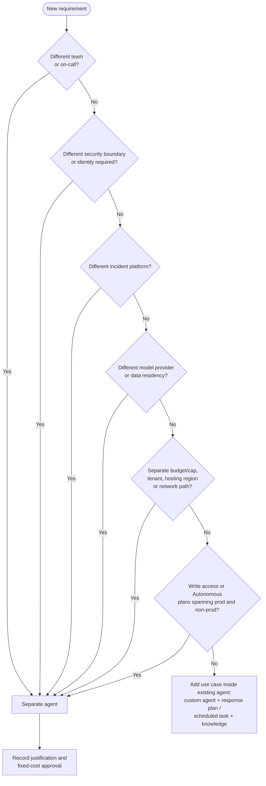

# Agent topology - one agent or several?

**Reference date: 20-10-2026.** Read this guide before creating an agent ([setup guide, gate 0](setup-guide.md#0-resolve-the-production-blocking-decisions)). It follows the Azure SRE Agent enterprise blueprint (v2) and Microsoft Learn: **one agent per operating team, with use cases inside the agent**. Create a separate agent only when a property that is fixed per agent must differ.

## 1. Default model

| Principle | What it means for the foundation |
|---|---|
| **One agent per team** | The CCoE/platform team runs one **platform-operations agent** for the ALZ platform, vending, shared networking, and the platform side of the AI and AKS accelerators. |
| **One agent, several workloads** | One agent can monitor many subscriptions, landing zones, and regions within its granted scope. Do not create an agent for each vended subscription, landing zone, or monitored region. |
| **Use cases go inside the agent** | Implement each use case as a **custom agent** (specialist), **response plan** (which alerts and how), **scheduled task** (recurring check), plus knowledge files or skills. |
| **Consolidate by default** | Each agent adds a fixed always-on charge of 4 AAU per agent-hour: about EUR 282.66 (France Central) to EUR 349.52 (West Europe) per month at the [retail snapshot](costs.md). Each agent also needs its own onboarding, memory, permissions, and review. |
| **Start safe** | Begin with the Reader permission level and run mode **Review**. Run mode is set per response plan or scheduled task, so it is not a reason to split agents. **Caveat 1:** new response plans and scheduled tasks default to **Autonomous**; only the agent-level fallback defaults to Review, so set Review explicitly on each plan or task. **Caveat 2:** the Reader level is not zero-write; it always includes **Monitoring Contributor** at subscription scope. |

Sources: [pricing and billing](https://learn.microsoft.com/en-us/azure/sre-agent/pricing-billing), [team onboarding](https://learn.microsoft.com/en-us/azure/sre-agent/team-onboard), [custom agents](https://learn.microsoft.com/en-us/azure/sre-agent/sub-agents), [run modes](https://learn.microsoft.com/en-us/azure/sre-agent/run-modes).

## 2. Requirements that trigger a separate agent

Split only when one of these per-agent properties must differ. A3, A4, A5 and A7 are technical per-agent limits. A1 is an organizational design rule from the blueprint and team-onboarding guidance; it is not enforced by the product. A2 and A6 are security/governance boundaries.

| # | Requirement that differs | Why it forces a separate agent | Foundation example |
|---|---|---|---|
| A1 | **Team and on-call** | An agent learns one team's services, on-call rotation, and escalation path. | A dedicated AKS platform team with its own rotation, separate from the ALZ platform team |
| A2 | **Permissions / security boundary** | Each agent has one identity; custom agents share it. If a boundary must not share an identity, it needs its own agent. | Regulated or critical-function scope that internal policy requires to have a distinct identity and approvers; a future write-capable agent alongside a read-only one |
| A3 | **Incident platform** | Only one incident platform can be active per agent: Azure Monitor, PagerDuty, or ServiceNow. | The platform team uses ServiceNow while the AI team uses PagerDuty |
| A4 | **Model provider and data residency** | The model provider is selected per agent. For EU Data Boundary coverage choose Azure OpenAI; Anthropic is excluded. | Scope that requires EUDB processing, next to a team that has accepted a global provider |
| A5 | **Budget** | The monthly AAU allocation and usage cap are set per agent. | FinOps requires a separate cost center or capped budget for a business unit |
| A6 | **Tenant** (kit addition) | The agent identity and RBAC are anchored in one Entra tenant. Assume a separate agent unless a cross-tenant access model has been validated and approved. | Separate tenant for a subsidiary or OT/critical-infrastructure organization |
| A7 | **Hosting region or network path** (kit addition) | The hosting region is fixed at creation and cannot be changed. The network/egress configuration is agent-level, and the VNet must be in the agent's region. | A residency requirement for a different hosting region; a private AKS or API path that needs a different VNet configuration |

**Production versus non-production - conditional (evaluated position):**

| Agent posture | Topology |
|---|---|
| Reader permission level, every plan and task explicitly in Review, no write tools | **One agent** may cover prod and non-prod. Run mode is per plan or task, and resource access is per resource group. |
| Any Privileged level, write-capable role, or Autonomous plan or task | **Separate prod and non-prod agents** (trigger A2), unless tool access policies and hooks demonstrably block cross-environment actions in negative tests. |
| Critical-infrastructure or regulated production scope | Prefer a **dedicated production agent**, and record the governing internal policy. |

Several controls apply to the whole agent rather than to a single plan, so they cannot separate environments inside one agent:
- **SRE Agent Administrator** can approve actions anywhere the agent's identity has access.
- **SRE Agent Standard User** can chat and query production through the agent's identity.
- Autonomous non-prod plans run with the **same managed identity**, including any production write roles.
- **One active-flow AAU cap:** when it is exhausted, the agent is unavailable for chat and actions until next month, so noisy non-prod work can block production investigations.
- **Memory and knowledge** are shared across the agent.

Sources: [user roles](https://learn.microsoft.com/en-us/azure/sre-agent/user-roles), [run modes](https://learn.microsoft.com/en-us/azure/sre-agent/run-modes), [agent permissions](https://learn.microsoft.com/en-us/azure/sre-agent/permissions), [pricing and billing](https://learn.microsoft.com/en-us/azure/sre-agent/pricing-billing).

**Not triggers on their own:**
- A new use case.
- A new subscription, landing zone, or region of monitored resources.
- A new workload owned by the same team.
- A desire for a "cleaner" agent.

Sources: [agent permissions](https://learn.microsoft.com/en-us/azure/sre-agent/permissions), [complete setup](https://learn.microsoft.com/en-us/azure/sre-agent/complete-setup), [model provider selection](https://learn.microsoft.com/en-us/azure/sre-agent/model-provider-selection), [data privacy](https://learn.microsoft.com/en-us/azure/sre-agent/data-privacy), [supported regions](https://learn.microsoft.com/en-us/azure/sre-agent/supported-regions), [network requirements](https://learn.microsoft.com/en-us/azure/sre-agent/network-requirements).

## 3. Requirements that trigger a new use case (same agent)

Add a use case to the existing agent when the scope stays within that agent's team, identity, incident platform, model, and budget, and any of the following is new.

| Requirement | Implement as |
|---|---|
| New signal or alert type (for example vending failure, AKS node pressure, or AI throttling) | New **response plan** with a filter on severity, service, or keyword |
| New domain expertise or tool set (network, AKS, AI, backup, cost) | New **custom agent**, with its own instructions, tools, and knowledge |
| New recurring check or report (readiness, drift, upgrade readiness, cost) | New **scheduled task**, initially in Review mode |
| New runbook or reference content | **Knowledge file** or **skill** attached to the relevant custom agent |
| New acceptance test, owner, or KPI within the same team | A new use-case record using the [use-case template](use-cases.md), with an exercise and a measure |
| New scope (subscription, resource group, or region) | Add a **resource-group/subscription scope** to the existing identity, then run a negative access test |

## 4. Decision flow

## 5. Per-use-case placement

Default: one **platform-operations agent** owned by the CCoE/platform team, assuming one tenant, one incident platform, an EUDB-eligible Azure OpenAI provider, and one budget. "Combine" means implementing the use case inside that agent.

| Use case | Placement | Implement inside the agent as | Separate agent only if |
|---|---|---|---|
| UC01 Vending failure triage | **Combine** | `vending-governance` custom agent; response plan for vending pipeline alerts | Vending is run by a separate team with its own on-call (A1) |
| UC02 Readiness and drift | **Combine** | Same `vending-governance` custom agent; daily or weekly scheduled task | Not for environment alone while the agent is read-only and in Review mode |
| UC03 DNS and private connectivity | **Combine** | `network` custom agent; response plan for DNS/connectivity alerts | A separate network/connectivity team with its own on-call or incident platform (A1/A3) |
| UC04 Change-correlated incidents | **Combine** | Platform triage (orchestrator) with a hand-off to domain specialists | No: cross-domain correlation requires a shared context |
| UC05 Monitoring blind spots | **Combine** | `observability` custom agent; weekly scheduled task | No |
| UC06 AI landing-zone onboarding | **Combine (conditional)** | `ai-platform` custom agent; scheduled acceptance check | A separate AI platform team (A1), a different model or residency requirement (A4), or a separate security boundary (A2) |
| UC07 AI capacity and throttling | **Combine (conditional)** | Same `ai-platform` custom agent; response plan for throttling/quota alerts | Same as UC06; keep UC06 and UC07 together in whichever agent owns the AI platform |
| UC08 AKS platform triage | **Combine (conditional)** | `aks-platform` custom agent; response plan for AKS alerts | A dedicated AKS platform team (A1), a different private-cluster network path (A7), or a separate incident platform (A3) |
| UC09 AKS upgrade readiness | **Combine (conditional)** | Same `aks-platform` custom agent; scheduled task before upgrade windows | Same as UC08; keep UC08 and UC09 together |
| UC10 Backup and restore assurance | **Combine** | `resilience` custom agent; scheduled task after restore tests | Backup is run by a separate team with its own on-call (A1) |
| UC11 Cost and telemetry anomaly | **Combine** | `finops` custom agent; weekly scheduled task | FinOps requires its own budget or cap (A5) or its own team agent (A1) |
| UC12 Incident-to-WAF loop | **Combine** | Scheduled task across all use cases in this agent | No; run it in each agent that exists |
| Future: write/remediation actions | **Separate or gated** | Preferably not in the read-only pilot agent | Write permissions require a separate boundary (A2). Alternatively widen per resource group after the trust gate in the [setup guide](setup-guide.md#9-operational-acceptance-measurement-and-rollback) |

**Workload teams.** Application teams in vended landing zones may run their own team agent, one per team rather than one per subscription. Do not add agent creation to the subscription-vending pipeline by default. Instead, vending should hand over the scope, telemetry, and owner so that the right team agent can add the new subscription.

## 6. Reference topologies

| Organization | Recommended topology | Indicative fixed cost/month (WE retail) |
|---|---|---|
| One CCoE/platform team runs ALZ, vending, AI LZ and AKS platform | **1 platform agent** containing UC01-UC12 | EUR 349.52 |
| Platform team plus a dedicated AKS platform team | **2 agents**: platform (UC01-UC07, UC10-UC12) and AKS (UC08-UC09, plus its own UC12) | EUR 699.04 |
| Platform, AKS, and AI platform teams, each with its own on-call | **3 agents**: UC06-UC07 and UC08-UC09 move out | EUR 1,048.56 |
| Additional mandated boundary (separate tenant, regulated scope, or a different incident platform or model) | Add **1 agent per boundary**, with its justification recorded | +EUR 349.52 each |
| Write-capable or Autonomous operation across prod and non-prod | **Separate prod and non-prod agents** per team | +EUR 349.52 per team |

The cost figures exclude active-flow tokens and the 30-day trial. See [costs.md](costs.md).

## 7. Governance record per agent

For each agent, record the following before creation and review them quarterly:
- Owning team and on-call.
- The trigger (A1-A7) that justifies the agent, or "default platform agent".
- Tenant, hosting region, and model provider.
- Incident platform.
- Resource scopes.
- Monthly AAU cap and budget owner.
- The use cases it contains.

Merge agents whose trigger no longer applies.
